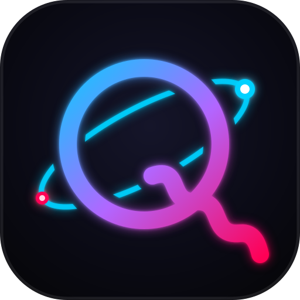
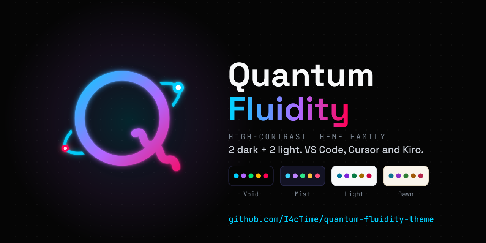
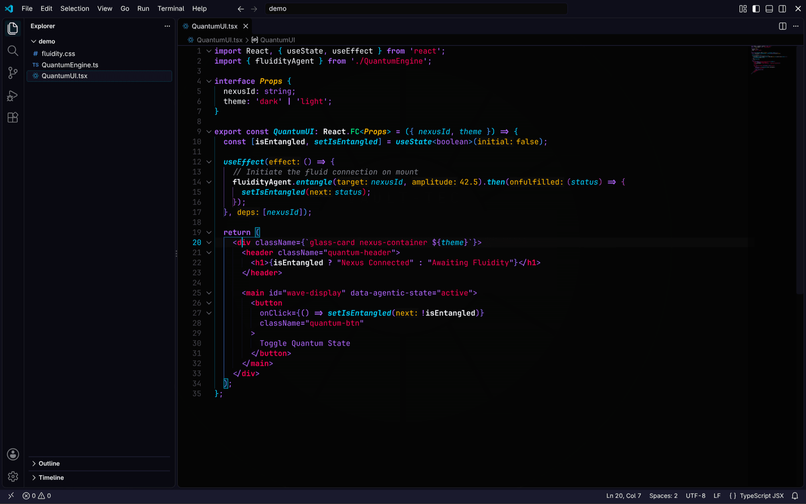
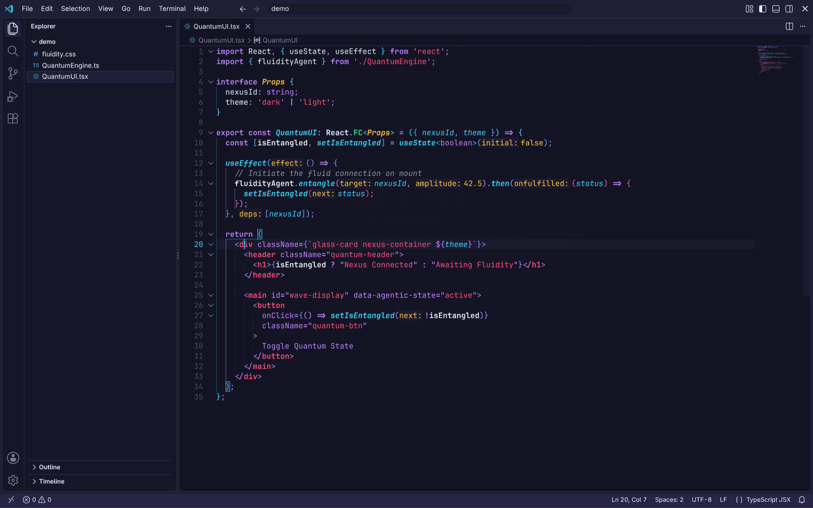
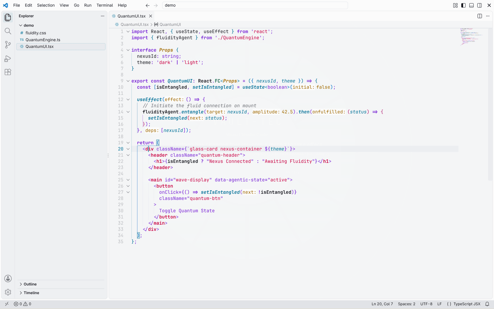
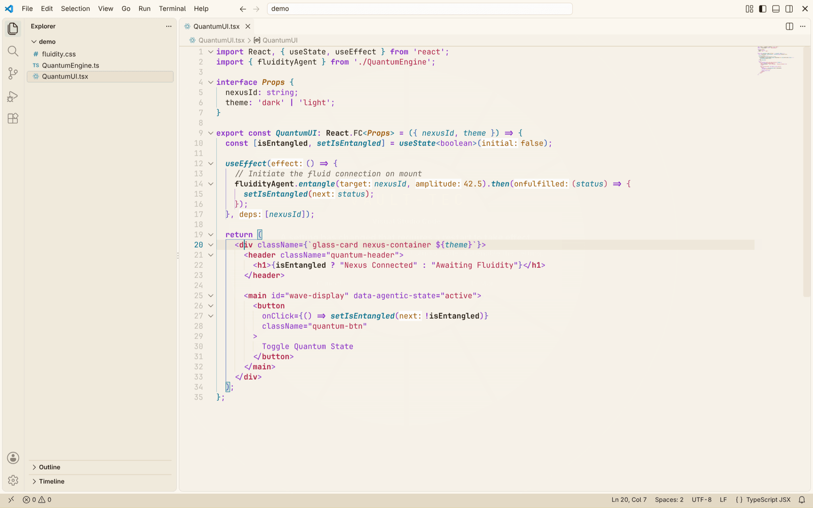

<div align="center">
  
  <h1>Quantum Fluidity</h1>
  <p><b>A crisp, high-contrast theme family for a development environment that feels both <i>quantum</i> and <i>agentic</i>.</b></p>
  <p>
    <a href="https://github.com/I4cTime/quantum-fluidity-theme/actions/workflows/ci.yml"></a>
    <a href="https://open-vsx.org/extension/I4cTime/quantum-fluidity-theme"></a>
    <a href="https://marketplace.visualstudio.com/items?itemName=I4cTime.quantum-fluidity-theme"></a>
    <a href="LICENSE"></a>
  </p>
</div>



**Quantum Fluidity** is an opinionated color theme family for **VS Code**, **Cursor** and **Kiro**. Four variants, two dark and two light, share one design system: vivid structural syntax highlighting that makes object-oriented and functional code easy to parse, WCAG-audited contrast in every variant, and every AI surface in the editor styled on-palette.

## The four variants

| Variant | Mode | Vibe |
| :--- | :--- | :--- |
| **Quantum Fluidity** | Dark | The signature `Obsidian Void`: pure-black foundation, maximum neon punch. |
| **Quantum Fluidity Mist** | Dark | `Midnight Mist` navy surfaces with gentler neons, cozier for long sessions and dim rooms. |
| **Quantum Fluidity Light** | Light | `Ghost White`: cool, crisp, high-contrast daylight coding. |
| **Quantum Fluidity Dawn** | Light | Warm paper surfaces with earthy quantum accents, easy on the eyes in bright environments. |

### Quantum Fluidity (Void)


### Quantum Fluidity Mist


### Quantum Fluidity Light


### Quantum Fluidity Dawn


## Features

- **2 x 2 modes.** Two dark and two light variants, all generated from a single palette source so they stay in sync.
- **WCAG-audited.** Every syntax color clears 4:1 contrast against its background (7:1+ for body text); brackets and hints clear 3:1. Verified by an automated check (`npm run check`) that fails CI on regression.
- **Built for agentic editors.** Chat panels, inline chat, next-edit suggestions, ghost text and inlay hints are all themed, so code the AI writes reads as cleanly as code you wrote. Cursor, Kiro and Copilot surfaces are covered.
- **Semantic highlighting.** Deep integration with language servers colorizes classes, interfaces, enums, type parameters, decorators and methods by structural meaning, not regex. Deprecated symbols are struck through. Pylance and rust-analyzer token types are mapped too.
- **Typographic hierarchy.** Bold keywords and italic parameters and attributes give code a flowing, readable texture.
- **Quantum brackets.** Nested brackets ramp through a six-level cyan to violet to pink gradient that maps the depth of your code, with matching bracket-pair guides and a cyan glow on the matching pair.
- **Full workbench coverage.** 750 workbench colors: menus, peek views, notifications, command palette, git decorations and the SCM graph, merge conflicts, sticky scroll, debug, testing and coverage, notebooks, terminal ANSI and command decorations, settings, welcome page, charts and symbol icons.

## The palette

Each role keeps its meaning across all four variants:

| Role | Void (Dark) | Mist (Dark) | Light | Dawn (Light) |
| :--- | :--- | :--- | :--- | :--- |
| **Foundation** (backgrounds) | `#050505` | `#131324` | `#F8F9FA` | `#FAF5EC` |
| **Electric Cyan** (functions, cursor, borders) | `#00D1FF` | `#3BD5FF` | `#007399` | `#0E7490` |
| **Hyper-Violet** (keywords, operators, badges) | `#B266FF` | `#BE83FF` | `#7C24D9` | `#8B2FC9` |
| **Neon Emerald** (classes, types) | `#00E676` | `#2EE68A` | `#067A43` | `#2E7D32` |
| **Neon Amber** (numbers, constants) | `#FFB800` | `#FFC53D` | `#A36A00` | `#A05A08` |
| **Quantum Pink** (strings, tags, errors) | `#FF0055` | `#FF4D7E` | `#CC0044` | `#B3264A` |
| **Containers** (mist surfaces, hovers) | `#1A1A2E` | `#262645` | `#E5E7EB` | `#E7DCC8` |

## Installation

### VS Code
1. Open the Extensions panel (`Ctrl+Shift+X` / `Cmd+Shift+X`).
2. Search for `Quantum Fluidity` and click **Install**.
3. `Ctrl+K Ctrl+T` (or Command Palette, `Preferences: Color Theme`) and pick your variant.

### Cursor
Cursor reads the same extension format. Search `Quantum Fluidity` in Cursor's Extensions panel (served from Open VSX), or install the `.vsix` manually (below).

### Kiro
Kiro installs extensions from **Open VSX**. Search `Quantum Fluidity` in Kiro's extensions view, or use the manual `.vsix` install.

### Manual (.vsix), works in all three editors
1. Grab the latest `.vsix` from [Releases](https://github.com/I4cTime/quantum-fluidity-theme/releases), or build it yourself with `npm run package`.
2. Command Palette, `Extensions: Install from VSIX...`, select the file.

## Development

The four theme JSONs are **generated**. Do not edit `themes/*.json` by hand.

```bash
npm install
npm run build        # regenerate themes/*.json from src/palettes.mjs
npm run check        # WCAG contrast audit (fails CI on regression)
npm run build:brand  # regenerate icon.png and the social cards from assets/brand/mark.svg
npm run package      # build + check + create the .vsix
```

- `src/palettes.mjs` is the single source of truth: one flat palette object per variant.
- `src/template.mjs` maps a palette onto the full VS Code theme structure (workbench colors, semantic tokens, TextMate scopes).
- `src/check-contrast.mjs` is the WCAG luminance-contrast audit for every palette.
- `src/build-brand.mjs` renders the marketplace icon and social cards from the vector mark in `assets/brand/`.

To add a fifth variant: add a palette object, run `npm run build`, add the theme entry to `package.json`.

### Releasing

CI (`.github/workflows/ci.yml`) runs on every push and PR: regenerates the themes, fails if `themes/*.json` were hand-edited, runs the contrast audit, and does a dry-run package.

Pushing a `v*` tag (for example `git tag v2.1.0 && git push origin v2.1.0`) triggers `.github/workflows/release.yml`, which publishes the same `.vsix` to **both** the VS Code Marketplace and **Open VSX** (where Cursor and Kiro install from), and attaches it to a GitHub Release. Open VSX uses trusted publishing (the workflow is registered as a trusted publisher on open-vsx.org, no token). The Marketplace step needs the `VSCE_PAT` repo secret (Azure DevOps, Marketplace Manage scope) and is skipped until it exists.

## License

[MIT](LICENSE). Made by [I4C Studio](https://i4c.studio).

---

<div align="center">
  <i>Enjoy the subtle glow and let your code flow.</i>
</div>
